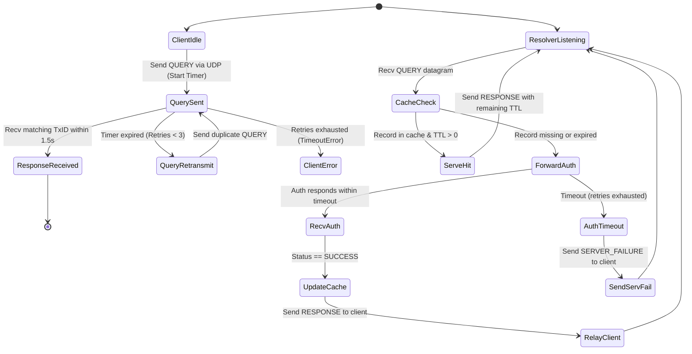

# MYDNS/1.0 Protocol Specification (RFC)

**Protocol Name:** `MYDNS/1.0`  
**Standard Track:** CS-327 Computer Communication Networks — Complex Engineering Problem (Option B)  
**Authors:** Abdur Rahman (`CS-24098`), Atta-Ur-Rehman (`CS-24092`), Asadullah Zafar (`CS-24082`)  
**Department:** Computer & Information Systems Engineering, NED University of Engineering & Technology  
**Document Status:** Final Draft / Standard Specification  

---

## 1. Overview and Purpose

`MYDNS/1.0` is a lightweight, binary application-layer name resolution protocol designed to operate directly over native UDP sockets (`socket.SOCK_DGRAM`). It provides recursive domain-to-IPv4 resolution between three distributed hosts:
1. **Client Node (Host 1):** Initiates domain lookup queries, measures round-trip time (RTT), and executes stop-and-wait retransmissions.
2. **Caching Recursive Resolver (Host 2):** Maintains an in-memory cache with dynamic Time-To-Live (TTL) decrementation, serving immediate cache hits or recursively forwarding cache misses.
3. **Authoritative Name Server (Host 3):** Holds the master zone database and authoritative TTL records for campus network domains.

The protocol emphasizes **strict wire compactness**, **deterministic parsing**, and **low computational overhead**, eliminating RFC 1035 compression complexity while guaranteeing byte-level encapsulation inspectability.

---

## 2. Wire Format Specification

All multi-byte numeric fields are transmitted in **Network Byte Order (Big-Endian)**. Communication consists of a fixed **64-bit (8-byte) header** followed by a structured, variable-length payload.

### 2.1 Bit-Level Packet Layout

```
 0                   1                   2                   3
 0 1 2 3 4 5 6 7 8 9 0 1 2 3 4 5 6 7 8 9 0 1 2 3 4 5 6 7 8 9 0 1
+-+-+-+-+-+-+-+-+-+-+-+-+-+-+-+-+-+-+-+-+-+-+-+-+-+-+-+-+-+-+-+-+
|        Transaction ID         |  Msg Type (8) |  Query Type(8)|
+-+-+-+-+-+-+-+-+-+-+-+-+-+-+-+-+-+-+-+-+-+-+-+-+-+-+-+-+-+-+-+-+
|   Status (8)  |   Reserved(8) |              TTL (16)         |
+-+-+-+-+-+-+-+-+-+-+-+-+-+-+-+-+-+-+-+-+-+-+-+-+-+-+-+-+-+-+-+-+
| Domain Length |               Domain Name (Variable)          |
+-+-+-+-+-+-+-+-+                                               +
|               | Resolved IPv4 Address (4 Bytes, if Response)  |
+-+-+-+-+-+-+-+-+-+-+-+-+-+-+-+-+-+-+-+-+-+-+-+-+-+-+-+-+-+-+-+-+
```

### 2.2 Header Fields (Exact 8 Bytes)

Packed using Python's native `struct` module with format string: **`!HBBBxH`**

| Field | Bit Offset | Width | Type | Description |
| :--- | :---: | :---: | :---: | :--- |
| **Transaction ID** | 0 – 15 | 16 bits | `uint16` (`!H`) | Identifier randomly generated by the client to correlate asynchronous request-response pairs. |
| **Message Type** | 16 – 23 | 8 bits | `uint8` (`!B`) | Indicates message role: `0x01` (QUERY), `0x02` (RESPONSE), `0x03` (ERROR). |
| **Query Type** | 24 – 31 | 8 bits | `uint8` (`!B`) | Type of lookup requested: `0x01` (`TYPE_A` for IPv4 address lookup). |
| **Status Code** | 32 – 39 | 8 bits | `uint8` (`!B`) | Execution outcome: `0x00` (SUCCESS), `0x01` (NXDOMAIN), `0x02` (SERVER_FAILURE), `0x03` (FORMAT_ERROR). Unused in queries (`0x00`). |
| **Reserved** | 40 – 47 | 8 bits | `uint8` (`x`) | Padding byte for 32-bit boundary alignment; must be set to `0x00`. |
| **TTL** | 48 – 63 | 16 bits | `uint16` (`!H`) | Time-To-Live validity in seconds (0 to 65,535s). Authoritative value on miss; decremented remaining value on cache hit. |

### 2.3 Payload Fields (Variable Length)

| Field | Width | Type | Description |
| :--- | :---: | :---: | :--- |
| **Domain Length** | 1 byte | `uint8` (`!B`) | Unsigned byte stating the length $L$ of the ASCII domain name string ($1 \le L \le 255$). |
| **Domain Name** | $L$ bytes | ASCII String | Case-insensitive Fully Qualified Domain Name (e.g., `portal.neduet.local`). |
| **Resolved IPv4** | 4 bytes | Raw Binary | Network-ordered 32-bit IPv4 address (`socket.inet_aton`). **Present only in RESPONSE packets (`msg_type == 0x02`)**. In QUERY packets, this 4-byte field is omitted on the wire to conserve bandwidth. |

**Packet Size Formulas:**
$$\text{Query Packet Length} = 8\text{ (header)} + 1\text{ (domain len)} + L\text{ (domain)} = 9 + L\text{ bytes}$$
$$\text{Response Packet Length} = 8\text{ (header)} + 1\text{ (domain len)} + L\text{ (domain)} + 4\text{ (IPv4)} = 13 + L\text{ bytes}$$

* *Example:* For `portal.neduet.local` ($L = 19$):
  * **QUERY Size:** $8 + 1 + 19 = 28\text{ bytes}$ (Header + Domain Length prefix + ASCII Domain).
  * **RESPONSE Size:** $8 + 1 + 19 + 4 = 32\text{ bytes}$ (Header + Domain Length + ASCII Domain + 4-byte IPv4).

---

## 3. Protocol Numerical Constants

```python
# Message Types (8 bits)
MSG_QUERY             = 0x01  # Client lookup request (status=0x00, IPv4 trailer omitted)
MSG_RESPONSE          = 0x02  # Resolver / Authoritative server answer (includes 4-byte IPv4)
MSG_ERROR             = 0x03  # Explicit protocol syntax/format error notification

# Query Types (8 bits)
TYPE_A                = 0x01  # Standard IPv4 Host Address query

# Status Codes (8 bits)
STATUS_SUCCESS        = 0x00  # Resolution succeeded; valid IPv4 returned
STATUS_NXDOMAIN       = 0x01  # Non-Existent Domain; record absent from zone
STATUS_SERVER_FAILURE = 0x02  # Resolver timed out querying authoritative server
STATUS_FORMAT_ERROR   = 0x03  # Malformed header, invalid length, or bad syntax
```

> **Semantic Separation of Errors:**
> * Standard name resolution outcomes—including positive answers (`STATUS_SUCCESS`), absent records (`STATUS_NXDOMAIN`), and upstream server unreachable errors (`STATUS_SERVER_FAILURE`)—are transmitted inside **`MSG_RESPONSE` (`0x02`)** packets.
> * **`MSG_ERROR` (`0x03`)** is reserved specifically for unrecoverable wire-level syntax violations (`STATUS_FORMAT_ERROR`, e.g., truncated headers, illegal domain length $L=0$, or corrupt framing) where a standard DNS response cannot be formulated.

---

## 4. Legal Message Exchange Sequences

### 4.1 Exchange 1: Cache Miss (Full 3-Host Recursive Resolution)
Triggered when the requested domain is not cached at Host 2 or its TTL has expired.

```
HOST 1 (Client)               HOST 2 (Resolver)             HOST 3 (Auth Server)
      |                              |                              |
      |--- 1. QUERY (TxID: 101) ---->|                              |
      |    domain: portal.neduet.local                              |
      |    (No IPv4 trailer: 28B)    |--- 2. QUERY (TxID: 101) ---->|
      |                              |    domain: portal.neduet.local
      |                              |    (No IPv4 trailer: 28B)    |
      |                              |                              |
      |                              |<-- 3. RESPONSE (TxID: 101)---|
      |                              |    ip: 10.0.1.5, ttl: 120    |
      |                              |    (With IPv4 trailer: 32B)  |
      |                              |    [Stores in Memory Cache]  |
      |<-- 4. RESPONSE (TxID: 101)---|                              |
      |    ip: 10.0.1.5, ttl: 120    |                              |
      |    (With IPv4 trailer: 32B)  |                              |
```

### 4.2 Exchange 2: Cache Hit (Immediate Resolver Response)
Triggered when the requested domain exists in Host 2's cache and `current_time < expires_at`.

```
HOST 1 (Client)               HOST 2 (Resolver)             HOST 3 (Auth Server)
      |                              |                              |
      |--- 1. QUERY (TxID: 202) ---->|                              |
      |    domain: portal.neduet.local                              |
      |    (No IPv4 trailer: 28B)    | [Cache Hit: computes]        | (Zero Traffic)
      |                              | [remaining_ttl = 105s]       |
      |<-- 2. RESPONSE (TxID: 202)---|                              |
      |    ip: 10.0.1.5, ttl: 105    |                              |
      |    (With IPv4 trailer: 32B)  |                              |
```

### 4.3 Exchange 3: Non-Existent Domain (`NXDOMAIN`)
Triggered when the queried domain does not exist in Host 3's master zone records.

```
HOST 1 (Client)               HOST 2 (Resolver)             HOST 3 (Auth Server)
      |                              |                              |
      |--- 1. QUERY (unknown.local)->|--- 2. QUERY (unknown.local)->|
      |                              |<-- 3. RESPONSE --------------|
      |                              |    status: STATUS_NXDOMAIN   |
      |                              |    ip: 0.0.0.0, ttl: 0       |
      |<-- 4. RESPONSE --------------|                              |
      |    status: STATUS_NXDOMAIN   |                              |
      |    ip: 0.0.0.0, ttl: 0       |                              |
```

### 4.4 Exchange 4: Upstream Failure & Timeout (`SERVER_FAILURE`) (Requirement R7)
Triggered when Host 3 is offline, crashed, or dropping datagrams. To satisfy the client stop-and-wait timeout of $1.5\text{s}$, Host 2 waits $0.5\text{s}$ per upstream attempt ($1.0\text{s}$ total across 2 attempts), reliably returning `SERVER_FAILURE` to Host 1 before Host 1's retransmission timer triggers.

```
HOST 1 (Client)               HOST 2 (Resolver)             HOST 3 (Auth Server)
      |                              |                              |
      |--- 1. QUERY (TxID: 404) ---->|                              |
      |    (Client timer: 1.5s)      |--- 2. QUERY (Attempt 1) ---->| (X Server Offline)
      |                              |    [Wait 0.5s timeout]       |
      |                              |--- 3. QUERY (Attempt 2) ---->| (X Dropped)
      |                              |    [Wait 0.5s timeout]       |
      |<-- 4. RESPONSE (TxID: 404)---|                              |
      |    (Arrives at T = 1.0s)     |                              |
      |    status: SERVER_FAILURE    |                              |
      |    ip: 0.0.0.0, ttl: 0       |                              |
```

---

## 5. Protocol State Machine



---

## 6. Serialization & Parsing Rules (SerDes)

### 6.1 Serialization Algorithm (`pack`)
1. **Header Packing:**
   * Pack `tx_id` (16b), `msg_type` (8b), `query_type` (8b), `status` (8b), and `ttl` (16b) into an 8-byte buffer using `struct.pack('!HBBBxH', tx_id, msg_type, query_type, status, ttl)`.
   * *Note on Padding:* Format code `x` automatically inserts the 1-byte `0x00` padding; exactly **5 arguments** must be passed to `struct.pack`.
2. **Domain Encoding:**
   * Encode ASCII domain name string into bytes (`domain_bytes = domain.encode('ascii')`).
   * Validate domain length: if $\text{len}(domain\_bytes) < 1$ or $\text{len}(domain\_bytes) > 255$, raise `ValueError("Domain length must be between 1 and 255 characters")`.
   * Pack 1-byte length prefix: `struct.pack('!B', len(domain_bytes))`.
3. **Conditional IP Address Encoding:**
   * **If `msg_type == MSG_RESPONSE` (`0x02`):** Convert IPv4 string (e.g. `'10.0.1.5'`) to 4 raw bytes using `socket.inet_aton(ip)`. For error responses (`NXDOMAIN`, `SERVER_FAILURE`), encode `'0.0.0.0'` (`b'\x00\x00\x00\x00'`).
   * **If `msg_type == MSG_QUERY` (`0x01`) or `MSG_ERROR` (`0x03`):** Do **not** encode or append an IP address trailer.
4. **Assembly:**
   * **Response Packet:** `header_bytes + length_byte + domain_bytes + ip_bytes` ($13 + L$ bytes).
   * **Query / Error Packet:** `header_bytes + length_byte + domain_bytes` ($9 + L$ bytes).

### 6.2 Deserialization Algorithm (`unpack`)
1. **Minimum Length Check:**
   * Base packet length must satisfy $\text{len}(data) \ge 10\text{ bytes}$ ($8\text{ header} + 1\text{ len} + 1\text{ char min}$). If not, raise `ValueError("Packet truncated below minimum 10-byte threshold")`.
2. **Header Unpacking:**
   * Unpack the first 8 bytes: `tx_id, msg_type, query_type, status, ttl = struct.unpack('!HBBBxH', data[:8])`.
3. **Domain Extraction & Boundary Validation:**
   * Read byte offset 8 as `domain_len = data[8]`.
   * Validate domain bounds: `if domain_len < 1 or domain_len > 255: raise ValueError(f"Invalid domain length: {domain_len}")`.
   * Boundary checks:
     * If `msg_type == MSG_RESPONSE`: verify $\text{len}(data) \ge 9 + domain\_len + 4$. If not, raise `ValueError("Response packet missing required 4-byte IPv4 trailer")`.
     * If `msg_type == MSG_QUERY`: verify $\text{len}(data) \ge 9 + domain\_len$.
   * Slice ASCII domain string: `domain = data[9 : 9 + domain_len].decode('ascii')`.
4. **Conditional IP Extraction:**
   * **If `msg_type == MSG_RESPONSE` (`0x02`):**
     * Slice trailing 4 bytes: `ip_bytes = data[9 + domain_len : 13 + domain_len]`.
     * Convert to standard dotted-decimal string: `ip_address = socket.inet_ntoa(ip_bytes)`.
   * **Else (`msg_type == MSG_QUERY`):**
     * Set `ip_address = None` (queries do not carry an answer address).

---

## 7. Encapsulation Model Mapping (Requirement R5)

When captured using Wireshark, every `MYDNS/1.0` packet cleanly maps onto the 4-layer network encapsulation model:

```
+---------------------------------------------------------------------------------------+
| LAYER 2: ETHERNET II FRAME                                                            |
| [ Dest MAC (6B) ] [ Src MAC (6B) ] [ EtherType: 0x0800 (IPv4) (2B) ]                  |
+---------------------------------------------------------------------------------------+
  |                                                                                    
  v                                                                                    
+---------------------------------------------------------------------------------------+
| LAYER 3: IPv4 DATAGRAM                                                                |
| [ Version/IHL (1B) ] [ Total Length (2B) ] [ Protocol: 17 (UDP) (1B) ]                 |
| [ Source IP (4B) ] [ Destination IP (4B) ]                                            |
+---------------------------------------------------------------------------------------+
    |                                                                                  
    v                                                                                  
+---------------------------------------------------------------------------------------+
| LAYER 4: UDP DATAGRAM                                                                 |
| [ Source Port (2B) ] [ Dest Port: 53000/53053 (2B) ] [ UDP Length (2B) ] [ Checksum ] |
+---------------------------------------------------------------------------------------+
      |                                                                                
      v                                                                                
+---------------------------------------------------------------------------------------+
| LAYER 7: MYDNS/1.0 APPLICATION PAYLOAD                                                |
| [ TxID (2B) ] [ MsgType (1B) ] [ QType (1B) ] [ Status (1B) ] [ Pad (1B) ] [ TTL (2B)] |
| [ Domain Len (1B) ] [ Domain String (Variable) ] [ IPv4 (4B, if Response) ]           |
+---------------------------------------------------------------------------------------+
```

---

## 8. Reference Python API (`src/protocol.py`)

All three group members must import and use the standardized `MYDNSMessage` class:

```python
from protocol import (
    MYDNSMessage,
    MSG_QUERY,
    MSG_RESPONSE,
    MSG_ERROR,
    TYPE_A,
    STATUS_SUCCESS,
    STATUS_NXDOMAIN,
    STATUS_SERVER_FAILURE,
    STATUS_FORMAT_ERROR,
)

# Example: Constructing a Query (Host 1) - Packs to 28 bytes for 19-char domain (No IPv4 trailer)
query = MYDNSMessage(
    tx_id=0xA1B2,
    msg_type=MSG_QUERY,
    query_type=TYPE_A,
    domain="portal.neduet.local"
)
raw_wire_bytes = query.pack()  # len(raw_wire_bytes) == 28 bytes

# Example: Parsing on Resolver / Server (Host 2 / Host 3)
parsed_msg = MYDNSMessage.unpack(raw_wire_bytes)
print(f"Domain requested: {parsed_msg.domain}, TxID: {hex(parsed_msg.tx_id)}")

# Example: Constructing a Success Response (Host 3 / Host 2) - Packs to 32 bytes (Includes IPv4 trailer)
response = MYDNSMessage(
    tx_id=parsed_msg.tx_id,
    msg_type=MSG_RESPONSE,
    query_type=TYPE_A,
    status=STATUS_SUCCESS,
    ttl=120,
    domain=parsed_msg.domain,
    ip_address="10.0.1.5"
)
wire_response_bytes = response.pack()  # len(wire_response_bytes) == 32 bytes
```


