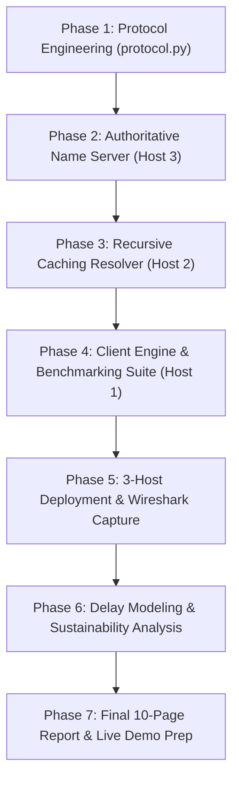

# Project Execution Plan: CS-327 CCN CEP
**Project Title:** Design, Implementation, and Evaluation of a Multi-Host Networked Application  
**Selected Track:** Option B — Mini DNS Service (`MYDNS/1.0`)  
**Timeline:** Week 09 (Proposal) to Week 13 (Live Demonstration & Final Report)  
**Target:** 50 / 50 Marks (Level 4 across all Rubric Criteria)

---

## 1. Project Phases & Milestone Roadmap

---

## 2. Detailed Phase Breakdown

### Phase 1: Protocol Engineering & Binary Serialization (`src/protocol.py`)
* **Lead Member:** Abdur Rahman (`CS-24098`)
* **Key Tasks:**
  - [ ] Implement `MYDNSMessage` class in `src/protocol.py` using Python's native `struct` module.
  - [ ] Fixed 8-byte binary header (`!HBBBxH`):
    - Transaction ID (16 bits)
    - Message Type (8 bits): `0x01` (Query), `0x02` (Response), `0x03` (Error)
    - Query Type (8 bits): `0x01` (TYPE_A)
    - Status Code (8 bits): `0x00` (SUCCESS), `0x01` (NXDOMAIN), `0x02` (SERVER_FAILURE), `0x03` (FORMAT_ERROR)
    - Reserved/Padding (8 bits): `0x00`
    - TTL (16 bits): Unsigned short
  - [ ] Dynamic payload serialization:
    - 1-byte domain length prefix + variable ASCII string + 4-byte packed IPv4 (`socket.inet_aton`).
  - [ ] Implement robust `pack()` and `unpack()` methods with boundary/length validation.
  - [ ] Write unit tests to verify byte-exact packing and unpacking without data corruption.

---

### Phase 2: Authoritative Name Server (`src/authoritative_server.py`)
* **Lead Member:** Abdur Rahman (`CS-24098`)
* **Key Tasks:**
  - [ ] Create `src/zone.json` containing master domain-to-IPv4 mappings with authoritative TTLs (e.g., `portal.neduet.local`, `lms.neduet.local`, `mail.neduet.local`).
  - [ ] Implement `src/authoritative_server.py` using raw UDP sockets (`socket.AF_INET`, `socket.SOCK_DGRAM`) listening on port `53053`.
  - [ ] Parse incoming queries:
    - If domain exists in zone: reply with status `0x00` (SUCCESS), resolved IPv4, and zone TTL.
    - If domain missing: reply with status `0x01` (`NXDOMAIN`), TTL `0`, and IP `0.0.0.0`.
  - [ ] Add clean server logging with timestamps, source IP, requested domain, and returned status.

---

### Phase 3: Recursive Caching Resolver (`src/resolver.py`)
* **Lead Member:** Atta-Ur-Rehman (`CS-24092`)
* **Key Tasks:**
  - [ ] Implement dual-socket architecture:
    - Server socket: listens on UDP port `53000` for client queries.
    - Forwarding client socket: forwards cache misses to Host 3 (`53053`).
  - [ ] Build in-memory cache dictionary:
    - Store: `cache[domain] = {"ip": resolved_ip, "expires_at": time.time() + ttl}`.
  - [ ] Dynamic TTL handling:
    - On Cache Hit: calculate `remaining_ttl = int(expires_at - time.time())`. If `remaining_ttl <= 0`, evict from cache and trigger cache miss.
  - [ ] Multi-threaded / non-blocking concurrency:
    - Handle incoming queries concurrently (using `socketserver.ThreadingUDPServer` or threading worker pool) so slow authoritative lookups don't block other client queries (Rubric Criterion 2, Level 4).
  - [ ] Failure detection & timeout recovery (R7):
    - Set socket timeout on Host 3 forwarder (`socket.settimeout(2.0)`).
    - If Host 3 fails to respond after retries, construct and return a `SERVER_FAILURE` (`0x02`) packet to the client.

---

### Phase 4: Client Benchmarking Engine & Statistical Profiler (`src/client.py`)
* **Lead Member:** Asadullah Zafar (`CS-24082`)
* **Key Tasks:**
  - [ ] Implement interactive CLI client:
    - Accepts `--resolver-ip`, `--resolver-port`, `--domain`.
    - Generates random 16-bit Transaction ID (`os.urandom(2)`).
    - Sends UDP query, starts high-resolution timer (`time.perf_counter()`).
    - Implements stop-and-wait timeout retransmission (timeout 1.5s, max 3 attempts).
    - Prints resolved IP, remaining TTL, and RTT in milliseconds.
  - [ ] Create automated benchmarking tool (`tests/benchmark_runner.py`):
    - Executes $\ge 5$ trials (e.g., 10 to 20 runs) under two comparative conditions:
      1. Condition A: Cache Miss (first query or expired record).
      2. Condition B: Cache Hit (subsequent back-to-back queries).
    - Calculates descriptive statistics: Minimum, Maximum, Arithmetic Mean ($\mu$), and Sample Standard Deviation ($\sigma$ / spread).
    - Generates comparison table and exports high-resolution visual plots (`rtt_comparison.png`).

---

### Phase 5: 3-Host Deployment, Wireshark Capture & Failure Demo
* **Collaborative Team Task** (All 3 members)
* **Key Tasks:**
  - [ ] Deploy onto 3 separate endpoints (3 physical laptops via mobile hotspot or 1 host + 2 bridged VMs).
  - [ ] Document IP addressing plan with screenshots of `ipconfig` / `ip addr` on each host.
  - [ ] Open Wireshark on Host 1 and Host 2:
    - Capture live packet exchange for both Cache Hit and Cache Miss.
    - Dissect and annotate all 4 protocol layers: Frame $\rightarrow$ IPv4 $\rightarrow$ UDP $\rightarrow$ `MYDNS/1.0`.
  - [ ] Execute deliberate Failure Demonstration (R7):
    - Terminate Host 3 (Authoritative Server).
    - Execute client query; observe resolver timeout and `SERVER_FAILURE` response.
    - Save Wireshark `.pcap` trace and terminal logs as tangible proof.

---

### Phase 6: Delay Modeling & Sustainability Analysis
* **Lead Member:** Asadullah Zafar & Atta-Ur-Rehman
* **Key Tasks:**
  - [ ] **Nodal Delay Modeling ($T_{nodal}$):**
    - Express measured RTT as:
      $$T_{nodal} = d_{proc} + d_{queue} + d_{trans} + d_{prop}$$
    - Deconstruct why Cache Hit saves an entire round-trip traversal:
      $$RTT_{miss} = 2 \cdot (d_{prop1} + d_{trans1}) + 2 \cdot (d_{prop2} + d_{trans2}) + d_{proc(resolver)} + d_{proc(auth)}$$
      $$RTT_{hit} = 2 \cdot (d_{prop1} + d_{trans1}) + d_{proc(cache\_lookup)}$$
  - [ ] **Sustainability & Energy Scaling (CLO-3):**
    - Quantify exact byte reduction: $268\text{ bytes (miss)} \rightarrow 134\text{ bytes (hit)} = 50\%\text{ wire savings}$.
    - Scale to NED University campus scenario (12,000 active devices, 60 queries/day, 80% hit ratio).
    - Compute daily megabytes saved ($\approx 77.2\text{ MB/day} \approx 2.31\text{ GB/month}$) and reason about router buffer occupancy and NIC sleep states.

---

### Phase 7: Final Report Compilation & Live Viva Preparation
* **Collaborative Team Task** (All 3 members)
* **Key Tasks:**
  - [ ] Compile 10-page report strictly adhering to Section 9 structure and Times New Roman 12/14 formatting.
  - [ ] Attach the official grading rubric as the exact title page with group details filled in.
  - [ ] Complete and sign the Individual Contributions Table.
  - [ ] Include the AI Assistance Declaration Appendix detailing Gemini prompt interactions.
  - [ ] Rehearse live demonstration: ensure every team member can defend any part of the architecture, protocol byte packing, socket operations, and measurement methodology.

