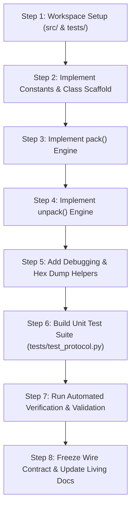

# Protocol Implementation Plan: `src/protocol.py`

**Project:** `MYDNS/1.0` — Mini DNS Service (Option B)  
**Course:** CS-327 Computer Communication Networks (Fall 2026)  
**Lead Responsible:** Abdur Rahman (`CS-24098`) — *Lead: Protocol Engineering & Authoritative Server*  
**Collaborators:** Atta-Ur-Rehman (`CS-24092`), Asadullah Zafar (`CS-24082`)  
**Target File:** `src/protocol.py`  
**Test Suite:** `tests/test_protocol.py`  
**Status:** Ready for Implementation

---

## 1. Objectives & Executive Scope

`src/protocol.py` is the **single shared backbone dependency** across all three network endpoints (Host 1: Client, Host 2: Resolver, Host 3: Authoritative Server). As established in `Implementation Constraint.md` and `Decisions.md` (ADR-009), the three hosts share no memory, database, or runtime threads. They communicate strictly over low-level UDP datagrams structured according to this module.

### Core Goals:
1. **Zero External Dependencies:** Use only Python standard libraries (`struct`, `socket`, `typing`).
2. **Strict Bit-Level Fidelity:** Implement the exact 64-bit (8-byte) header (`!HBBBxH`) in Network Byte Order (Big-Endian).
3. **Deterministic Variable-Length SerDes:**
   * Query packets: Header (8B) + Domain Len (1B) + ASCII Domain ($L$B) = **$9 + L$ bytes** (No IPv4 trailer).
   * Response packets: Header (8B) + Domain Len (1B) + ASCII Domain ($L$B) + IPv4 (4B) = **$13 + L$ bytes**.
4. **Resilient Boundary Guards:** Explicit validation against packet truncation, empty domains ($L=0$), domain overflow ($L>255$), and non-ASCII character injection.
5. **100% Test Coverage:** Automated unit test suite verifying round-trip byte preservation, error raises, and big-endian wire alignment.

---

## 2. Technical Architecture & Invariant Specifications

### 2.1 Wire Layout Reference

```
 0                   1                   2                   3
 0 1 2 3 4 5 6 7 8 9 0 1 2 3 4 5 6 7 8 9 0 1 2 3 4 5 6 7 8 9 0 1
+-+-+-+-+-+-+-+-+-+-+-+-+-+-+-+-+-+-+-+-+-+-+-+-+-+-+-+-+-+-+-+-+
|        Transaction ID         |  Msg Type (8) |  Query Type(8)|
+-+-+-+-+-+-+-+-+-+-+-+-+-+-+-+-+-+-+-+-+-+-+-+-+-+-+-+-+-+-+-+-+
|   Status (8)  |   Reserved(8) |              TTL (16)         |
+-+-+-+-+-+-+-+-+-+-+-+-+-+-+-+-+-+-+-+-+-+-+-+-+-+-+-+-+-+-+-+-+
| Domain Length |               Domain Name (Variable)          |
+-+-+-+-+-+-+-+-+                                               +
|               | Resolved IPv4 Address (4 Bytes, if Response)  |
+-+-+-+-+-+-+-+-+-+-+-+-+-+-+-+-+-+-+-+-+-+-+-+-+-+-+-+-+-+-+-+-+
```

### 2.2 Numerical Constants

```python
# Message Types (8 bits)
MSG_QUERY             = 0x01  # Client lookup request (IPv4 trailer omitted)
MSG_RESPONSE          = 0x02  # Resolver / Authoritative server answer (includes 4-byte IPv4)
MSG_ERROR             = 0x03  # Wire-level format violation notification

# Query Types (8 bits)
TYPE_A                = 0x01  # Standard IPv4 Host Address query

# Status Codes (8 bits)
STATUS_SUCCESS        = 0x00  # Resolution succeeded; valid IPv4 returned
STATUS_NXDOMAIN       = 0x01  # Non-Existent Domain; record absent from zone
STATUS_SERVER_FAILURE = 0x02  # Resolver timed out querying authoritative server
STATUS_FORMAT_ERROR   = 0x03  # Malformed header, invalid length, or bad syntax
```

### 2.3 Struct Format Details
* **Format String:** `!HBBBxH`
  * `!`: Network Byte Order (Big-Endian).
  * `H`: Transaction ID (unsigned 16-bit short, 2 bytes).
  * `B`: Message Type (unsigned 8-bit char, 1 byte).
  * `B`: Query Type (unsigned 8-bit char, 1 byte).
  * `B`: Status Code (unsigned 8-bit char, 1 byte).
  * `x`: Pad Byte (1 byte, auto-filled with `0x00` by `struct.pack`).
  * `H`: TTL (unsigned 16-bit short, 2 bytes).
* **Argument Invariant:** `struct.pack('!HBBBxH', tx_id, msg_type, query_type, status, ttl)` takes **exactly 5 arguments**.

---

## 3. Implementation Steps Breakdown



---

### Step 1: Directory Setup & Structure Verification
Ensure the source and test directories exist in the project:
* Create `src/` directory (if not already present).
* Create `tests/` directory (if not already present).
* Add empty `__init__.py` files in `src/` and `tests/` to facilitate clean Python imports.

---

### Step 2: Protocol Class Scaffold & Constants (`src/protocol.py`)
Define the class signature with comprehensive docstrings and type hints:

```python
from typing import Optional
import socket
import struct

# Constants definition
...

class MYDNSMessage:
    def __init__(
        self,
        tx_id: int,
        msg_type: int,
        query_type: int = TYPE_A,
        status: int = STATUS_SUCCESS,
        ttl: int = 0,
        domain: str = "",
        ip_address: Optional[str] = None
    ) -> None:
        ...
```

#### Field Validation Rules in `__init__`:
* `0 <= tx_id <= 0xFFFF` (16-bit unsigned short).
* `msg_type in (MSG_QUERY, MSG_RESPONSE, MSG_ERROR)`.
* `query_type == TYPE_A` (`0x01`).
* `status in (STATUS_SUCCESS, STATUS_NXDOMAIN, STATUS_SERVER_FAILURE, STATUS_FORMAT_ERROR)`.
* `0 <= ttl <= 0xFFFF` (16-bit unsigned short).

---

### Step 3: Serialization Implementation (`pack`)
Develop the binary encoder:

1. **Header Pack:**
   ```python
   header_bytes = struct.pack(
       '!HBBBxH',
       self.tx_id,
       self.msg_type,
       self.query_type,
       self.status,
       self.ttl
   )
   ```
2. **Domain Encoding & Bounds Validation:**
   ```python
   try:
       domain_bytes = self.domain.encode('ascii')
   except UnicodeEncodeError as e:
       raise ValueError(f"Domain must contain only ASCII characters: {e}")

   domain_len = len(domain_bytes)
   if not (1 <= domain_len <= 255):
       raise ValueError(f"Domain length must be between 1 and 255 bytes (got {domain_len})")

   domain_payload = struct.pack('!B', domain_len) + domain_bytes
   ```
3. **Conditional IPv4 Trailer:**
   ```python
   if self.msg_type == MSG_RESPONSE:
       ip_str = self.ip_address if self.ip_address else "0.0.0.0"
       try:
           ip_bytes = socket.inet_aton(ip_str)
       except OSError as e:
           raise ValueError(f"Invalid IPv4 address format '{ip_str}': {e}")
       return header_bytes + domain_payload + ip_bytes
   else:
       # For MSG_QUERY and MSG_ERROR, omit the 4-byte IP trailer
       return header_bytes + domain_payload
   ```

---

### Step 4: Deserialization Implementation (`unpack`)
Develop the binary decoder with robust multi-tier boundary guards:

1. **Base Minimum Length Guard:**
   * A valid Query must have at least $8\text{ (header)} + 1\text{ (len)} + 1\text{ (min 1-char domain)} = 10\text{ bytes}$.
   * If `len(data) < 10`: raise `ValueError("Packet truncated below minimum 10-byte threshold")`.
2. **Header Parsing:**
   * `tx_id, msg_type, query_type, status, ttl = struct.unpack('!HBBBxH', data[:8])`
3. **Domain Length Validation:**
   * `domain_len = data[8]`
   * If `domain_len < 1 or domain_len > 255`: raise `ValueError(f"Invalid domain length: {domain_len}")`.
4. **Payload Boundary Checks:**
   * **If `msg_type == MSG_RESPONSE`:**
     * Expected minimum: $8 + 1 + domain\_len + 4 = 13 + domain\_len$.
     * If `len(data) < 13 + domain_len`: raise `ValueError("Response packet missing required 4-byte IPv4 trailer")`.
     * Extract Domain: `domain = data[9 : 9 + domain_len].decode('ascii')`.
     * Extract IP: `ip_bytes = data[9 + domain_len : 13 + domain_len]`.
     * Convert IP: `ip_address = socket.inet_ntoa(ip_bytes)`.
   * **If `msg_type == MSG_QUERY` or `MSG_ERROR`:**
     * Expected minimum: $9 + domain\_len$.
     * If `len(data) < 9 + domain_len`: raise `ValueError("Query packet payload truncated")`.
     * Extract Domain: `domain = data[9 : 9 + domain_len].decode('ascii')`.
     * `ip_address = None`.
5. **Instance Instantiation:** Return `cls(tx_id, msg_type, query_type, status, ttl, domain, ip_address)`.

---

### Step 5: Debugging & String Helpers
Implement diagnostic tools directly within `MYDNSMessage`:
* `__repr__()`: Human-readable summary for console logging.
* `to_dict()`: JSON-serializable dictionary representation for debugging.
* `hex_dump()`: Formatted hex view of packed wire bytes for comparison against Wireshark captures (Requirement R5).

---

### Step 6: Automated Unit Test Suite (`tests/test_protocol.py`)
Build a comprehensive test suite using Python's standard `unittest` framework:

| Test Case Name | Target Behavior | Validation Criteria |
| :--- | :--- | :--- |
| `test_query_pack_unpack()` | Standard Query serialization | Packed length == 28 bytes for `portal.neduet.local` ($8 + 1 + 19$); round-trip unpacked fields match exactly; `ip_address is None`. |
| `test_response_success_pack_unpack()` | Success Response serialization | Packed length == 32 bytes ($8 + 1 + 19 + 4$); `ip_address == "10.0.1.5"`; `ttl == 120`. |
| `test_response_nxdomain()` | NXDOMAIN Response | `status == STATUS_NXDOMAIN`, `ip_address == "0.0.0.0"`, `ttl == 0`. |
| `test_response_server_failure()` | SERVER_FAILURE Response | `status == STATUS_SERVER_FAILURE`, `ip_address == "0.0.0.0"`. |
| `test_minimum_domain_length()` | Boundary test $L=1$ (`"a"`) | Query is 10B; Response is 14B; unpacks cleanly without off-by-one errors. |
| `test_maximum_domain_length()` | Boundary test $L=255$ | Query is 264B; Response is 268B; full 255-char string preserved. |
| `test_zero_length_domain_rejected()` | Invalid domain ($L=0$) | `pack()` raises `ValueError`; malformed packet with $L=0$ raises `ValueError` in `unpack()`. |
| `test_domain_overflow_rejected()` | Invalid domain ($L=256$) | `pack()` raises `ValueError`. |
| `test_non_ascii_domain_rejected()` | Unicode domain injection | `pack()` raises `ValueError`. |
| `test_truncated_header()` | Packet < 10 bytes | `unpack()` raises `ValueError`. |
| `test_truncated_response_missing_ip()` | Response with domain but missing IPv4 | `unpack()` raises `ValueError`. |
| `test_big_endian_wire_layout()` | Verify Network Byte Order (`!`) | Verify `tx_id = 0xA1B2` maps to bytes `b'\xA1\xB2'`; `ttl = 120` (`0x0078`) maps to bytes `b'\x00\x78'`. |

---

## 4. Execution Commands & Verification Protocol

### Command to Execute Unit Tests:
```powershell
python -m unittest discover -s tests -p "test_*.py" -v
```

### Expected Output:
```text
test_big_endian_wire_layout (test_protocol.TestMYDNSProtocol) ... ok
test_domain_overflow_rejected (test_protocol.TestMYDNSProtocol) ... ok
test_maximum_domain_length (test_protocol.TestMYDNSProtocol) ... ok
test_minimum_domain_length (test_protocol.TestMYDNSProtocol) ... ok
test_non_ascii_domain_rejected (test_protocol.TestMYDNSProtocol) ... ok
test_query_pack_unpack (test_protocol.TestMYDNSProtocol) ... ok
test_response_nxdomain (test_protocol.TestMYDNSProtocol) ... ok
test_response_server_failure (test_protocol.TestMYDNSProtocol) ... ok
test_response_success_pack_unpack (test_protocol.TestMYDNSProtocol) ... ok
test_truncated_header (test_protocol.TestMYDNSProtocol) ... ok
test_truncated_response_missing_ip (test_protocol.TestMYDNSProtocol) ... ok
test_zero_length_domain_rejected (test_protocol.TestMYDNSProtocol) ... ok

----------------------------------------------------------------------
Ran 12 tests in 0.005s

OK
```

---

## 5. Post-Implementation Hand-Off & Synchronization

Once `src/protocol.py` is implemented and verified by running `tests/test_protocol.py`:

1. **Calculate SHA-256 Checksum:** Compute and publish the file hash to ensure all 3 team members use an identical copy.
2. **Update Living Audit Files:**
   * Update [Decisions.md](file:///c:/projects/Sentra_DNS/Decisions.md) to record the transition of `protocol.py` from Planned to Implemented.
   * Update [flow.md](file:///c:/projects/Sentra_DNS/flow.md) to confirm verified function signatures and wire byte counts.
3. **Module Unblocking:**
   * **Abdur Rahman:** Begins building `src/authoritative_server.py` and `src/zone.json`.
   * **Atta-Ur-Rehman:** Begins building `src/resolver.py` with multi-threading and cache locking.
   * **Asadullah Zafar:** Begins building `src/client.py` and `tests/benchmark_runner.py`.

